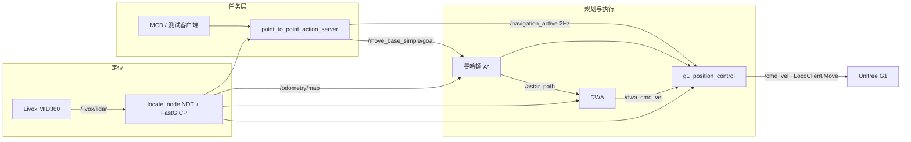

# Unitree G1 激光导航控制系统

> **G1 Navigation Controller** — 基于 ROS 2 Humble 的 Unitree G1 人形机器人点到点导航。
> 打通「先验点云地图定位 → 曼哈顿 A\* 全局规划 → DWA 局部避障 → 位置控制 / SDK 下发 → MCB 任务接口」。

面向室内定点行走：Livox MID360 在预先建好的点云地图上做配准定位，规划层按 G1「一段运动不同时输出 vx 与 vy」的约束生成轴对齐路径，执行层在主从心跳允许时才输出速度。

本仓库**不是在线 SLAM**。运行时只加载已有的 `map.pcd` 与二维栅格，在线不更新地图。三维地图由仓库外的 FAST-LIO 一类里程计离线生成；二维栅格由本仓库 `scripts/pcd2pgm.py` 从 PCD 投影得到。

---

## 目录

- [1. 项目简介](#1-项目简介)
- [2. 仓库结构](#2-仓库结构)
- [3. 环境要求](#3-环境要求)
- [4. 快速开始](#4-快速开始)
- [5. 算法设计](#5-算法设计)
- [6. 接口与通信协议](#6-接口与通信协议)
- [7. 地图说明](#7-地图说明)
- [8. 安全设计](#8-安全设计)
- [9. 关键常量速查](#9-关键常量速查)
- [10. 已知问题与注意事项](#10-已知问题与注意事项)
- [11. 文档索引](#11-文档索引)
- [12. 常见问题 FAQ](#12-常见问题-faq)
- [13. 作者](#13-作者)

---

## 1. 项目简介

导航包位于 `src/navigation_controller/`。colcon 工作空间里与本目录相关的五个 ROS 2 包是：`fast_gicp`、`livox_ros_driver2`、`mid360_locate`、`robot_interfaces`、`navigation_controller`。

| 层 | 职责 | 关键文件 |
|---|---|---|
| **任务层** | 接收 MCB 点到点 Goal，做校验、超时、抢占、急停与进度反馈 | `scripts/point_to_point_action_server.py` |
| **全局规划** | 占用栅格膨胀、曼哈顿 A\*、路径平滑与轴对齐 | `scripts/astar_planner_ros2_Manhattan.py` |
| **局部规划** | 实时点云聚类、DWA 采样评分、卡住逃逸 | `scripts/dwa_planner_ros2_mid360.py` |
| **执行层** | 主从心跳门控、路点跟踪、DWA 仲裁，发布 `/cmd_vel` 并可选 SDK 行走 | `scripts/g1_position_control_ros2.py` |
| **定位层** | 加载 PCD，首帧 NDT、后续 FastGICP，置信度与跳变门控 | `pkg/mid360_locate/src/locate_node_ros2.cpp` |
| **接口层** | MCB 与导航端共用的 Action IDL | `robot_interfaces/action/navigation/PointToPoint.action` |



判定部署版的依据是 `launch/fusion_ros2.launch.py` 拉起的可执行文件，以及 `CMakeLists.txt` 里 `install(PROGRAMS scripts/...)`。`navigation_controller/nodes/` 与 `scripts/` 已经分叉，**launch 不使用 `nodes/`**。Action 服务器没有写进 launch，需要第二个终端单独启动。

---

## 2. 仓库结构

```
g1_navigation_controller_v1/
├── README.md                              # 本文档（位于导航主包之外）
├── docs/                                  # 流程图与系统说明 HTML
├── version_history_readme.md              # 早期提交的版本差异说明
├── src/
│   ├── robot_interfaces/                  # 工作空间根上的接口包副本
│   └── navigation_controller/             # 导航主包 ★
│       ├── launch/fusion_ros2.launch.py   # 系统启动入口
│       ├── config/config_env.yaml         # 网卡、地图文件名、速度、硬件开关
│       ├── config/ekf_localization.yaml   # EKF（50 Hz，LiDAR + IMU）
│       ├── scripts/                       # 部署版 Python 节点
│       ├── navigation_controller/nodes/   # 旧 Python 模块，launch 不使用
│       ├── robot_interfaces/              # 包内接口定义
│       ├── pkg/mid360_locate/             # 定位节点
│       ├── pkg/fast_gicp/                 # FastGICP / NDT（第三方）
│       ├── pkg/livox_ros_driver2/         # MID360 驱动（第三方）
│       ├── map/                           # 仅保留说明文本，不含地图数据
│       ├── rviz/visualization_fixed.rviz
│       ├── Docs/                          # 架构、协议与快速开始
│       ├── CMakeLists.txt                 # 现行构建入口（ament_cmake）
│       └── setup.py                       # 残留 setuptools 入口，不以它为准
```

`setup.py` 的 `console_scripts` 指向 `navigation_controller.nodes`，和 launch 实际安装的 `scripts/` 不一致。发布与运行以 CMake 安装结果为准。

---

## 3. 环境要求

| 组件 | 版本 / 说明 |
|---|---|
| 操作系统 | Ubuntu 22.04 |
| ROS 2 | **Humble** |
| Python | 3.10；numpy、scipy、PyYAML、transforms3d、sensor_msgs_py；生成栅格另需 open3d |
| C++ | C++17 源码；PCL、Eigen3、pcl_ros、pcl_conversions |
| 导航依赖 | `nav2_map_server`、`nav2_lifecycle_manager`、`robot_localization`、`tf2_ros` |
| 硬件 | Unitree G1；Livox MID360（含 IMU）；硬件模式需要 `unitree_sdk2py` |
| 雷达网络 | 主机与雷达 IP 见 `pkg/livox_ros_driver2/config/MID360_config.json`（示例：主机 `192.168.123.99`，雷达 `192.168.123.120`） |

```bash
sudo apt install -y \
  ros-humble-nav2-map-server ros-humble-nav2-lifecycle-manager \
  ros-humble-robot-localization ros-humble-pcl-ros ros-humble-pcl-conversions \
  ros-humble-tf2-ros ros-humble-rviz2
```

历史工作空间路径是 `~/ros2_ws_nav`。部分 launch 仍写着 `/home/york/...`，换机器后要以本仓库路径和 `config_env.yaml` 为准。

---

## 4. 快速开始

假定本仓库放在 `~/ros2_ws_nav/src` 的上一级，或已把 `src/navigation_controller` 放到工作空间的 `src/` 下。下面按仓库自带布局书写：包在 `src/navigation_controller`。

### 4.1 构建

`pkg/` 里的 vendor 包不在工作空间 `src` 的第一层，需要 `--base-paths`。Livox 驱动靠 `ROS_EDITION` 选择 ROS 2 分支。

```bash
cd ~/ros2_ws_nav
source /opt/ros/humble/setup.bash
export ROS_EDITION=ROS2

colcon build --base-paths src/navigation_controller/pkg --symlink-install
source install/setup.bash
colcon build --packages-select robot_interfaces --symlink-install
source install/setup.bash
colcon build --packages-select navigation_controller --symlink-install
source install/setup.bash
```

构建前把 `map/地图文件说明.txt` 里要求的 `map.pcd`、`map.pgm`、`map.yaml` 放到 `src/navigation_controller/map/`。没有 PCD 时定位节点无法初始化。

核对网卡：`config/config_env.yaml` 的 `network_interface`、`use_hardware`。仓库里的网卡名是某台工控机的取值，换机必须改。`use_hardware` 当前默认是 `false`。

### 4.2 实机启动

终端 1：

```bash
source ~/ros2_ws_nav/install/setup.bash
ros2 launch navigation_controller fusion_ros2.launch.py \
    use_hardware:=true \
    hardware_interface:=<G1_DDS网卡名>
```

终端 2（Action 服务器必须另开）：

```bash
ros2 run navigation_controller point_to_point_action_server.py
```

无显示器时加上 `use_rviz:=false`。指定场景地图：

```bash
ros2 launch navigation_controller fusion_ros2.launch.py \
    use_hardware:=true \
    hardware_interface:=<G1_DDS网卡名> \
    map_file:=/abs/path/map.yaml \
    pcd_file:=/abs/path/map.pcd
```

只看静态 TF 和栅格、不接雷达：

```bash
ros2 launch navigation_controller fusion_ros2.launch.py \
    use_hardware:=false use_livox:=false use_localization:=false
```

该模式**不能**闭环导航。launch 在关闭定位时会尝试启动 `simulation_odometry_publisher.py`，当前 `scripts/` 与 `CMakeLists.txt` 都没有这个文件。

### 4.3 操作顺序

1. `ros2 topic hz /livox/lidar` 确认点云。
2. RViz「2D Pose Estimate」发布 `/initialpose`。`locate_node` 在收到该消息前不进入定位主循环。
3. 观察 `/odometry/map` 与 `/localization_confidence`，置信度稳定后再下发任务。
4. `ros2 action list` 中应出现 `/action_nav_point_to_point`。
5. 由 MCB 发 Goal，或向 `/move_base_simple/goal` 发布目标。只点 RViz「2D Nav Goal」、不启动 Action 时，位置控制**不会**输出速度。
6. 急停与解除：

```bash
ros2 topic pub /emergency_stop std_msgs/Bool "{data: true}" --once
ros2 topic pub /emergency_stop std_msgs/Bool "{data: false}" --once
```

到达后 `status_code = 0`，`/navigation_active` 变为 false，速度归零。

---

## 5. 算法设计

### 5.1 定位：NDT 初始化 + FastGICP 跟踪

源码：`pkg/mid360_locate/src/locate_node_ros2.cpp`。

地图预处理：体素 0.2 m 下采样，RANSAC 平面分割（距离阈值 0.1 m）提取地面，把地面法线旋到 +Z 并平移到约 z = 0，再按 `map_roll / map_pitch / map_yaw` 旋转。

每一帧 Livox 点云：

1. 保留水平距离约 0.5–50 m 的点，坐标做固定握手 `(x, −y, −z)`，对应 MID360 安装朝向。
2. 法向估计（k = 20）后，用法向空间采样抽到 4000 点，避免大墙面稀释约束。
3. 按速度裁剪局部地图，半径钳制在 15–80 m（基线 25 m，加减速剧烈时再乘 1.2）。
4. 首帧用 NDT，初值来自 `/initialpose`；后续帧用 FastGICP，初值是上一帧位姿。
5. 质量不合格则拒绝更新，保持上一帧位姿。

| 配准器 | 参数 |
|---|---|
| NDT | 分辨率 1.0 m，步长 0.1，最大迭代 30，收敛阈值 1e-8 |
| FastGICP | 8 线程，最大对应距离 0.5 m |

置信度在 `RegistrationQuality::getConfidence()` 中由适应度、内点比例、迭代次数、点数和帧间变化加权得到。硬编码门控：置信度低于 **0.15**、位置跳变大于 **4.0 m**、或旋转跳变大于 **2.0 rad** 时拒绝该帧。

`main_ros2.cpp` 真正读到的 ROS 参数只有 `map_file_path`、`points_type`、`topic_name`、`map_roll`、`map_pitch`、`map_yaw`。launch 里传给 `locate_node` 的 `min_confidence`、`ndt_resolution`、`enable_motion_compensation`、`max_rotation_error` **不会被节点读取**。门槛以 C++ 常量为准。

速度因此被压得很低：线速度约 0.20–0.25 m/s，角速度约 0.08 rad/s。G1 步行晃动和转身点云畸变容易让配准发散。

### 5.2 全局规划：曼哈顿 A\*

源码：`scripts/astar_planner_ros2_Manhattan.py`。

订阅 `/map`，用欧氏距离变换做膨胀。机器人半径 0.35 m，膨胀半径 0.15 m，膨胀区标记为 99，约每 2 s 发布 `/inflated_map`。

搜索是 4 连通、单位代价的二叉堆 A\*。启发式是曼哈顿距离，作为「每次只沿一个轴移动」的可采纳下界。后处理 `smooth_path_for_g1`：

1. 去掉转角过小的冗余点（约 30° 以内）。
2. 线性插值到约 0.3 m 间隔。
3. 三点移动平均，碰撞则退回原始点。
4. 斜线段拆成 L 形，保证每一段单轴可行。

### 5.3 局部规划：DWA

源码：`scripts/dwa_planner_ros2_mid360.py`。控制周期约 10 Hz，消费 frame 为 `map` 的 `/aligned`。

障碍：距离 `detection_range`（launch 覆盖为 1.5 m）、前向 ±90°、高度 `[-0.3, 0.6] m`；按 0.4 m 聚类，保留不少于 60 点的簇。每周期约 100 条候选轨迹，前向积分 1.5 s。碰撞惩罚是连续的，而不是越过半径就一刀切：

```python
ROBOT_SAFETY_RADIUS = 0.4
if effective_distance < ROBOT_SAFETY_RADIUS:
    collision_risk -= 100 * math.exp(-effective_distance / 0.2)
elif effective_distance < 1.0:
    collision_risk -= 30.0 / (effective_distance + 0.1)
```

线速度、角速度做一阶低通（`smooth_factor` 0.3）。launch 覆盖后的典型上限：`max_speed = 0.20 m/s`，`max_turn = 0.08 rad/s`。

约 5 s 内位移小于 0.15 m 且有线速度指令时进入逃逸：360° 分 8 个扇区，选最空旷方向，再按后退、转向、前进的顺序脱困。

### 5.4 位置控制与主从门控

源码：`scripts/g1_position_control_ros2.py`。10 Hz。

`/navigation_active` 为 false，或心跳超过 5 s，立即发零速度。由 false 转 true 时复位路点索引，避免上一个任务的状态留下来。

路点推进距离默认 0.5 m，最终到达阈值 `goal_tolerance` 默认 **0.20 m**。航向偏差大于约 0.5 rad 时原地转，硬件角速度下限约 0.15 rad/s（电机启动阈值）。避障激活且 `/dwa_cmd_vel` 在 0.5 s 内有效时采用 DWA 速度，否则跟踪 A\* 路点。

`use_hardware:=true` 时同时发布 `/cmd_vel` 和 `LocoClient.Move(vx, vy, vyaw)`。SDK 初始化失败则降级为只发布 `/cmd_vel`。G1 的 DDS 网卡和 Livox 网卡不必是同一块。

期望 TF 链：

```
map → odom → base_link → pelvis → lidar_frame → livox_frame
```

`pelvis → lidar_frame` 的平移是 `(0, 0, 0.3)` m。定位开启时，`locate_node` 发布 `map → base_link`，EKF 同时发布 `map → odom` 与 `odom → base_link`，`base_link` 会有两条 TF 路径。规划和控制订阅的是 `/odometry/map`，不使用 EKF 输出。

---

## 6. 接口与通信协议

IDL：`src/navigation_controller/robot_interfaces/action/navigation/PointToPoint.action`。生成后的类型名是 `robot_interfaces/action/PointToPoint`。MCB 与导航端必须编译同一份接口。

| 项 | 值 |
|---|---|
| Action 名 | `/action_nav_point_to_point` |
| 位姿输入 | `/odometry/map` |
| 执行许可 | `/navigation_active`（`std_msgs/Bool`，任务期内约 2 Hz） |
| 急停 | `/emergency_stop`（`std_msgs/Bool`） |
| 全局路径 | `/astar_path` |
| 局部速度 | `/dwa_cmd_vel` |
| 下发速度 | `/cmd_vel` |

**Goal**：`task_id`（string），`target_pose`（`geometry_msgs/PoseStamped`）。`frame_id` 必须是 `map`，否则 REJECT。未收到里程计或急停已置位时同样 REJECT。

**Feedback**（约 5 Hz）：当前位姿与速度、`navigation_state`（PLANNING / FOLLOWING / AVOIDING / RECOVERING / STUCK）、`obstacle_proximity`、剩余距离与时间、`localization_confidence`。

**Result `status_code`**：

| 码 | 含义 |
|---|---|
| 0 | 到达 |
| 1 | 任务超时 |
| 2 | 定位丢失 |
| 3 | 路径被挡 / 卡住恢复失败 |
| 4 | 目标不可达 |
| 5 | 取消或被新目标抢占 |
| 6 | 急停 |

上层应以 `status_code` 判断终态。服务器里有给 `result.result` 赋 `"success"` / `"failed"` 的语句，该字段不在 IDL 中。

Action 服务器默认监控：`goal_tolerance` 0.20 m；定位置信度阈值 0.20，低置信度持续约 5 s 判丢失；卡住 5.0 s / 0.1 m；恢复 10 s；任务超时 `min(150 + 距离 × 5, 180)` 秒。A\* 在 10 s 内无路径则目标不可达。

QoS：点云与 `/odometry/map` 为 BEST_EFFORT；`/cmd_vel`、路径、目标和心跳为 RELIABLE；`/map` 为 RELIABLE + TRANSIENT_LOCAL。

传感器流与控制话题的类型约定、以及一次任务的时序，见 `src/navigation_controller/Docs/README 202609.md` 第 4 节。

---

## 7. 地图说明

`src/navigation_controller/map/` **故意不提交地图**。目录里只有 `地图文件说明.txt`。

读者需要自己把 PCD 放进 `map/`，并配上同一场景的 `map.pgm` 与 `map.yaml`。默认文件名是 `map.pcd` 与 `map.yaml`。不入库有两个原因：单个 PCD 可达数百 MB，而且地图是现场扫描，属于私密数据。

由 PCD 生成栅格：在放好 `map.pcd` 的目录运行 `scripts/pcd2pgm.py`。高度带 `z ∈ [-0.8, 1.0] m`，分辨率 0.05 m/像素。脚本写出的 YAML 里 `resolution` 可能是空的 `float()`，需要手工改成 `0.05`。栅格和点云必须同一场景、同一坐标系。换场景后要重新给 `/initialpose`。

`.gitignore` 忽略 `map/` 下除说明文本以外的全部内容，以及全部 `*.pcd`、`*.pgm`。

---

## 8. 安全设计

1. **定位层**：置信度、位置跳变、旋转跳变任一越限就拒绝更新，不把跳变位姿交给控制。
2. **规划层**：栅格膨胀、DWA 安全半径 0.4 m、连续碰撞惩罚、卡住后的扇区逃逸。
3. **执行层**：没有 `/navigation_active` 心跳就不许动；心跳中断 5 s 停车；急停优先于任务。
4. **任务层**：目标坐标系校验、动态超时、定位丢失、路径阻塞、抢占与急停都有独立状态码。
5. **硬件开关**：只有显式 `use_hardware:=true` 才走 Unitree SDK。默认配置是关闭的。

速度上限是安全约束的一部分，不是调得越快越好。配准在转身时更容易失败，角速度保持在约 0.08 rad/s。

---

## 9. 关键常量速查

| 常量 | 值 | 位置 |
|---|---|---|
| 线速度上限 | 0.25 m/s（配置）/ 0.20 m/s（DWA launch 覆盖） | `config_env.yaml`、launch |
| 角速度上限 | 0.08 rad/s | `config_env.yaml`、DWA |
| 路点推进 / 到达阈值 | 0.5 m / 0.20 m | `config_env.yaml`、位置控制、Action |
| 心跳超时 | 5 s | 位置控制 |
| 控制周期 | 10 Hz | 位置控制、DWA |
| 机器人半径 / 膨胀 | 0.35 m / 0.15 m | A\* |
| DWA 检测距离 / 安全半径 | 1.5 m / 0.4 m | DWA |
| 栅格分辨率 | 0.05 m/像素 | `pcd2pgm.py`、`map.yaml` |
| NDT | 1.0 m，30 次迭代 | `locate_node_ros2.cpp` |
| 拒绝更新 | 置信度 < 0.15，平移 > 4 m，旋转 > 2 rad | `locate_node_ros2.cpp` |
| Action 超时 | min(150 + 5·距离, 180) s | Action 服务器 |
| 雷达安装高度假设 | pelvis 上方 0.3 m | 静态 TF |
| EKF | 50 Hz，LiDAR 位姿 + IMU | `ekf_localization.yaml` |

---

## 10. 已知问题与注意事项

| 问题 | 说明 |
|---|---|
| **Action 不在 launch 里** | 必须另开 `ros2 run navigation_controller point_to_point_action_server.py`，否则有路径也不会动。 |
| **`/obstacle_status` 类型不一致** | DWA 发布 `std_msgs/Int32`，位置控制按 `geometry_msgs/Point` 订阅。该回调进不去，避障切换不能依赖这个话题。 |
| **Action 订阅的障碍话题没有发布者** | 服务器订阅 `/dwa_obstacles`，DWA 实际发布 `/detected_obstacles`。Feedback 里的 `obstacle_proximity` 因此经常没有真实点云障碍。 |
| **定位参数被 launch 传了但不生效** | NDT 分辨率、置信度门槛、跳变上限以 C++ 源码常量为准。 |
| **仿真里程计脚本缺失** | `use_localization:=false` 时期望的 `simulation_odometry_publisher.py` 不在仓库中，无定位时没有 `/odometry/map`。 |
| **两套 Python 实现** | `scripts/` 是部署入口；`navigation_controller/nodes/` 是旧副本。改代码请改 `scripts/`。 |
| **`setup.py` 与 CMake 入口不一致** | 运行以 `CMakeLists.txt` 安装的脚本名为准。 |
| **IDL 注释与代码阈值不一致** | Action 文件注释里出现过 0.3 m 到达阈值；现行配置与服务器默认是 0.20 m。以代码为准。 |
| **`result.result` 不在 IDL 中** | 终态看 `status_code`。 |
| **TF 双路径** | 定位与 EKF 都会涉及 `base_link`。导航闭环用 `/odometry/map`。 |
| **网卡与 IP 是现场值** | `config_env.yaml` 与 `MID360_config.json` 换机器必须改。 |
| **地图不在仓库里** | 见第 7 节。没有 `map.pcd` 就不能定位。 |

---

## 11. 文档索引

| 文档 | 内容 |
|---|---|
| `src/navigation_controller/Docs/README 202609.md` | 架构、数据流、定位与导航算法、协议、构建与排障的详细说明 |
| `src/navigation_controller/Docs/QUICK_START.md` | 短步骤启动 |
| `src/navigation_controller/Docs/PointToPoint_Action_Guide.md` | Action 字段与调用说明 |
| `src/navigation_controller/Docs/Navigation_Control_Protocol_v1.0.md` | MCB 导航协议 |
| `src/navigation_controller/navigation_controller_Readme_CV.md` | 面向简历的技术说明 |
| `src/navigation_controller/map/地图文件说明.txt` | 为什么地图目录是空的，以及读者应放入什么 |
| `version_history_readme.md` | 2026-03 前后提交的差异记录（早于本次目录更新） |
| `docs/*.html` | 流程图、走廊部署、避障简报等图示 |

---

## 12. 常见问题 FAQ

**Q：有路径，机器人不动。**  
先确认第二个终端里的 Action 服务器在跑，并且 `/navigation_active` 约 2 Hz 为 true。只发 RViz 导航目标不会打开心跳。

**Q：`locate_node` 一直在等。**  
它在收到 `/initialpose` 之前不进入主循环。用 RViz「2D Pose Estimate」。

**Q：配准连续被拒绝。**  
初值离真值太远，或角速度太大。重新给初始位姿，并把转速保持在约 0.08 rad/s 附近。

**Q：构建找不到 `fast_gicp` 或 Livox 走了 ROS 1。**  
先 `export ROS_EDITION=ROS2`，并用 `colcon build --base-paths src/navigation_controller/pkg`。每次编完要 source `install/setup.bash`。

**Q：客户端等不到 Action。**  
名字是 `action_nav_point_to_point`，类型是 `robot_interfaces/action/PointToPoint`。MCB 侧的接口包必须和本仓库这份 IDL 一致。

**Q：克隆之后没有地图，定位起不来。**  
这是预期行为。按 `map/地图文件说明.txt` 自行放入 PCD 和栅格。

---

## 13. 作者

- **作者**：York GUO ｜ 邮箱：1739950387@qq.com
- 包元数据里的 maintainer 字段见 `src/navigation_controller/package.xml`
- 第三方：`pkg/fast_gicp`、`pkg/livox_ros_driver2` 保持上游许可，见各包内 LICENSE

---

> 建议的使用顺序：**先放入同一场景的 PCD 与栅格 → 只读点云与定位 → 确认 `/odometry/map` 稳定 → 再开 Action 做近距离点到点 → 最后才打开 `use_hardware:=true`。**
> 定位置信度不稳定时，正确的动作是停车并重新给 `/initialpose`，而不是提高速度上限。
